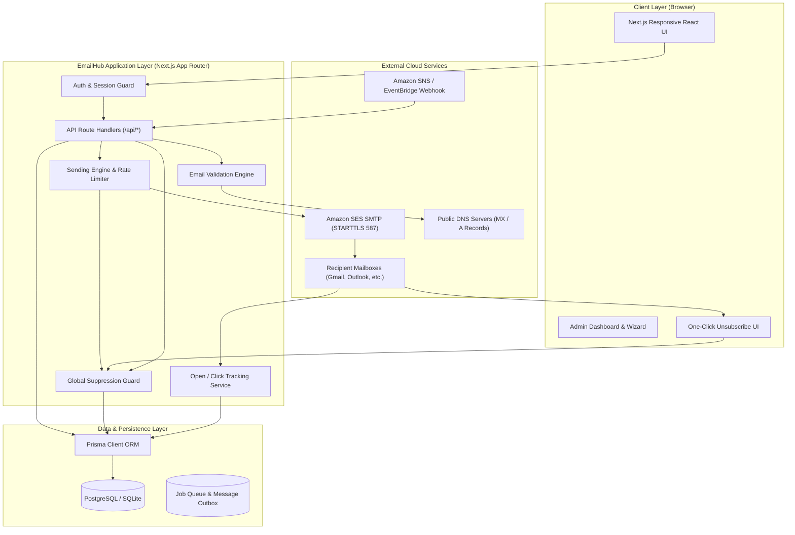
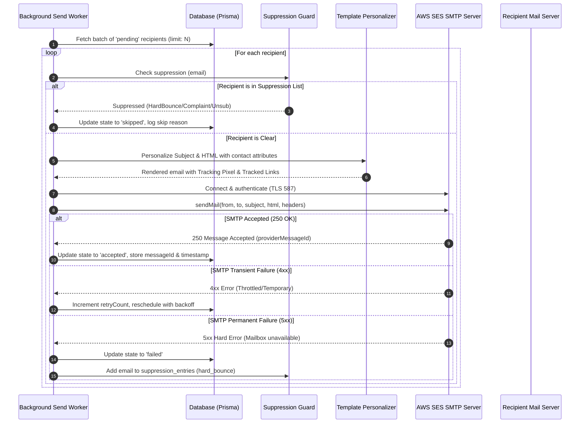

# System Architecture & Data Flow Document
## EmailHub — Architecture, Data Flow, and Engineering Diagrams

**Document Version:** 1.0.0  
**Status:** Approved  

---

## 1. System Architecture Overview

EmailHub is architected with a decoupled modular design separating presentation, transactional API routes, background queue execution, persistence, and external AWS SES integration.

---

## 2. Core Operational Data Flows

### 2.1 Campaign Creation & Audience Freezing Data Flow
1. **User** configures campaign metadata (Subject, From, Reply-to).
2. **User** selects target audience (Lists, Tags, Filter conditions).
3. **Audience Engine** queries contacts:
   - Deduplicates matching contacts by email.
   - Cross-checks `suppression_entries`. Matches marked `suppressed`.
   - Runs validation checks. Invalid syntax marked `invalid`.
   - Returns preview counts: Total, Eligible, Suppressed, Invalid.
4. **User** reviews template & confirms launch.
5. **Campaign Engine** creates a persistent snapshot in `campaign_recipients`:
   - Every eligible recipient gets an atomic row in state `pending`.
   - Campaign state transitions to `queued` -> `sending`.

### 2.2 Background Sending & Suppression Guard Data Flow

### 2.3 Real-Time Engagement Tracking Flow

#### Open Tracking Flow
1. Email client downloads HTML content.
2. Email client requests tracking image: `GET /api/track/open/:trackingId`.
3. Server receives request:
   - Validates `trackingId` exists in `email_messages`.
   - If `openedAt` is null, sets `openedAt = NOW()` and increments campaign `uniqueOpensCount`.
   - Always increments campaign `totalOpensCount`.
   - Inserts row in `email_events (type: 'open', ip, userAgent)`.
   - Returns HTTP 200 with 1x1 transparent GIF (Base64 decoded) with `Cache-Control: no-cache`.

#### Click Tracking Flow
1. Recipient clicks email link: `https://[app_url]/api/track/click/:linkId`.
2. Server receives request:
   - Looks up `linkId` in `email_links`.
   - Records event in `email_events (type: 'click', linkId, ip, userAgent)`.
   - Updates `firstClickedAt` and `clickCount`.
   - Updates campaign `uniqueClicksCount` and `totalClicksCount`.
   - Issues HTTP 302 redirect to original destination URL (`email_links.targetUrl`).

#### Unsubscribe Flow
1. Recipient clicks footer unsubscribe link: `https://[app_url]/unsubscribe?token=[hmac_token]`.
2. Server validates HMAC signature containing recipient email and campaign ID.
3. System marks contact status as `unsubscribed`.
4. System automatically inserts recipient email into `suppression_entries (category: 'unsubscribe')`.
5. Recipient sees confirmation: *"You have been successfully unsubscribed."*

---

## 3. High Availability & Failure Recovery Strategies

| Failure Scenario | Mitigation Architecture | Recovery Mechanism |
| :--- | :--- | :--- |
| **Worker Process Crash during Send** | Jobs are locked with a lease timestamp (`lockedAt`). | On worker boot, jobs with stale locks (`lockedAt < NOW() - 5m`) are reset to `pending` and retried idempotently. |
| **AWS SES Rate Limit Exceeded (454 / 554 Throttling)** | Leaky-bucket rate limiter configured to stay within account quota (e.g. 14 req/sec). | Worker catches 4xx throttle response, pauses queue for `backoffSeconds`, and requeues job without data loss. |
| **Network Timeout to SMTP Host** | Socket timeout set to 15,000ms. | Catch socket error, mark send as transient failure, schedule retry. |
| **Duplicate SNS / Webhook Event** | Unique index on `(providerMessageId, eventType, timestamp)`. | Webhook ingestion uses `upsert` or ignores already processed event IDs. |
