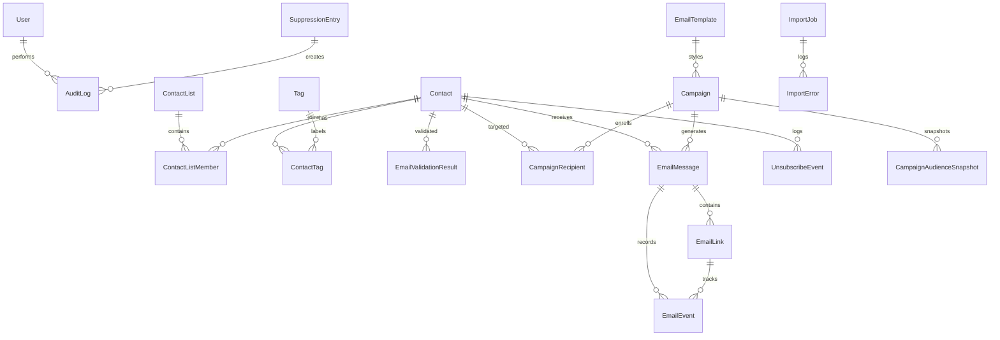

# Database Schema & Data Modeling Document
## EmailHub — Entity Relationship, Schema Definition & Indexing Strategy

**Document Version:** 1.0.0  
**Status:** Approved  
**ORM:** Prisma 5.x  
**Supported RDBMS:** PostgreSQL 14+ / SQLite (portable development)

---

## 1. Entity-Relationship Overview

---

## 2. Table Schemas & Definitions

### 2.1 Core Identity & Administration

#### `User`
Stores administrative user accounts.
- `id` (String, PK, UUID/cuid)
- `email` (String, Unique, Indexed)
- `passwordHash` (String)
- `name` (String)
- `role` (String, default: "admin") — "admin", "viewer", "editor"
- `createdAt` (DateTime, default: now())
- `updatedAt` (DateTime)

#### `ApplicationSettings`
Stores system configuration, send throttling, policies, and SES state.
- `id` (String, PK, default: "default")
- `smtpHost` (String)
- `smtpPort` (Int, default: 587)
- `smtpUsername` (String)
- `smtpPassword` (String, Encrypted)
- `smtpRegion` (String)
- `defaultFromName` (String)
- `defaultFromEmail` (String)
- `defaultReplyTo` (String, nullable)
- `appBaseUrl` (String)
- `maxSendRate` (Int, default: 14) — Max emails per second
- `maxSoftBounces` (Int, default: 3) — Consecutive soft bounces before auto-suppress
- `trackOpens` (Boolean, default: true)
- `trackClicks` (Boolean, default: true)
- `updatedAt` (DateTime)

---

### 2.2 Contacts & Segmentation

#### `Contact`
Master contact directory.
- `id` (String, PK)
- `email` (String, Unique, Indexed)
- `normalizedEmail` (String, Unique, Indexed)
- `firstName` (String, nullable)
- `lastName` (String, nullable)
- `fullName` (String, nullable)
- `department` (String, nullable, Indexed)
- `organization` (String, nullable)
- `jobTitle` (String, nullable)
- `phone` (String, nullable)
- `customAttributes` (JSON / Text) — Arbitrary key-values e.g. `{"designation":"Executive","dept_name":"Sales"}`
- `status` (String, default: "subscribed") — "subscribed", "unsubscribed", "bounced", "complained"
- `validationStatus` (String, default: "unknown") — "valid_format", "domain_valid", "invalid", "disposable", "unknown"
- `bounceCount` (Int, default: 0)
- `source` (String, default: "manual") — "manual", "import", "api"
- `createdAt` (DateTime, default: now(), Indexed)
- `updatedAt` (DateTime)

#### `ContactList`
Static contact groups.
- `id` (String, PK)
- `name` (String)
- `description` (String, nullable)
- `contactCount` (Int, default: 0)
- `createdAt` (DateTime, default: now())
- `updatedAt` (DateTime)

#### `ContactListMember`
Join table connecting Contacts to ContactLists.
- `id` (String, PK)
- `contactId` (String, FK -> Contact.id, Indexed)
- `listId` (String, FK -> ContactList.id, Indexed)
- `addedAt` (DateTime, default: now())
- *Constraint: Unique(`contactId`, `listId`)*

#### `Tag` & `ContactTag`
Dynamic labels.
- `Tag`: `id`, `name` (Unique), `color`, `createdAt`
- `ContactTag`: `contactId`, `tagId` (Unique composite PK)

---

### 2.3 Deliverability, Validation & Global Suppression

#### `SuppressionEntry`
**The critical deliverability shield.**
- `id` (String, PK)
- `email` (String, Unique, Indexed) — Normalized lowercase email
- `category` (String, Indexed) — `hard_bounce`, `soft_bounce`, `complaint`, `unsubscribe`, `admin_suppression`, `invalid_syntax`
- `reason` (String) — Technical explanation or SMTP code
- `providerMessageId` (String, nullable)
- `source` (String) — `ses_webhook`, `smtp_response`, `user_unsubscribe`, `admin_manual`, `pre_send_validation`
- `createdAt` (DateTime, default: now(), Indexed)
- `createdBy` (String, nullable)

#### `EmailValidationResult`
Cached validation diagnostics.
- `id` (String, PK)
- `email` (String, Unique, Indexed)
- `syntaxValid` (Boolean)
- `domainExists` (Boolean)
- `hasMxRecords` (Boolean)
- `isDisposable` (Boolean)
- `isRoleBased` (Boolean)
- `mxHost` (String, nullable)
- `status` (String) — `domain_valid`, `valid_format`, `invalid`, `disposable`, `unknown`
- `details` (String, nullable)
- `validatedAt` (DateTime, default: now(), Indexed)

---

### 2.4 Campaigns & Email Templates

#### `EmailTemplate`
Reusable email templates.
- `id` (String, PK)
- `name` (String)
- `description` (String, nullable)
- `category` (String, default: "general") — "newsletter", "announcement", "transactional", "invitation"
- `subject` (String, nullable)
- `preheader` (String, nullable)
- `htmlContent` (Text)
- `plainTextContent` (Text, nullable)
- `thumbnailUrl` (String, nullable)
- `createdAt` (DateTime, default: now())
- `updatedAt` (DateTime)

#### `Campaign`
Campaign state and aggregate telemetry.
- `id` (String, PK)
- `name` (String)
- `description` (String, nullable)
- `subject` (String)
- `preheader` (String, nullable)
- `fromName` (String)
- `fromEmail` (String)
- `replyTo` (String, nullable)
- `htmlContent` (Text)
- `plainTextContent` (Text, nullable)
- `templateId` (String, nullable, FK -> EmailTemplate.id)
- `status` (String, default: "draft", Indexed) — `draft`, `scheduled`, `queued`, `sending`, `paused`, `completed`, `cancelled`, `failed`
- `scheduledAt` (DateTime, nullable)
- `startedAt` (DateTime, nullable)
- `completedAt` (DateTime, nullable)
- `sendRate` (Int, default: 14)
- `trackOpens` (Boolean, default: true)
- `trackClicks` (Boolean, default: true)
- `totalRecipients` (Int, default: 0)
- `eligibleRecipients` (Int, default: 0)
- `sentCount` (Int, default: 0)
- `deliveredCount` (Int, default: 0)
- `failedCount` (Int, default: 0)
- `skippedCount` (Int, default: 0)
- `bouncedCount` (Int, default: 0)
- `complaintCount` (Int, default: 0)
- `uniqueOpensCount` (Int, default: 0)
- `totalOpensCount` (Int, default: 0)
- `uniqueClicksCount` (Int, default: 0)
- `totalClicksCount` (Int, default: 0)
- `unsubscribedCount` (Int, default: 0)
- `createdAt` (DateTime, default: now())
- `updatedAt` (DateTime)

#### `CampaignRecipient`
Audience snapshot and delivery lifecycle per contact.
- `id` (String, PK)
- `campaignId` (String, FK -> Campaign.id, Indexed)
- `contactId` (String, nullable, FK -> Contact.id, Indexed)
- `email` (String, Indexed)
- `name` (String, nullable)
- `customAttributes` (JSON / Text, nullable)
- `status` (String, default: "pending", Indexed) — `pending`, `processing`, `accepted`, `delivered`, `bounced`, `complained`, `skipped`, `failed`
- `skipReason` (String, nullable)
- `retryCount` (Int, default: 0)
- `lastError` (String, nullable)
- `providerMessageId` (String, nullable, Indexed)
- `sentAt` (DateTime, nullable)
- `deliveredAt` (DateTime, nullable)
- `openedAt` (DateTime, nullable)
- `clickedAt` (DateTime, nullable)
- `createdAt` (DateTime, default: now())

---

### 2.5 Outbox Messages, Tracking & Analytics

#### `EmailMessage`
Represents an individual message generated (either single send or campaign item).
- `id` (String, PK)
- `campaignId` (String, nullable, FK -> Campaign.id, Indexed)
- `contactId` (String, nullable, FK -> Contact.id, Indexed)
- `recipientEmail` (String, Indexed)
- `fromEmail` (String)
- `subject` (String)
- `status` (String, default: "pending", Indexed) — `pending`, `accepted`, `delivered`, `bounced`, `complained`, `failed`, `skipped`
- `providerMessageId` (String, nullable, Indexed)
- `trackingId` (String, Unique, Indexed) — UUID for open tracking pixel
- `sentAt` (DateTime, nullable)
- `deliveredAt` (DateTime, nullable)
- `openedAt` (DateTime, nullable)
- `openCount` (Int, default: 0)
- `clickedAt` (DateTime, nullable)
- `clickCount` (Int, default: 0)
- `createdAt` (DateTime, default: now())

#### `EmailLink`
Tracks rewritten URLs within outgoing emails.
- `id` (String, PK)
- `messageId` (String, FK -> EmailMessage.id, Indexed)
- `campaignId` (String, nullable, FK -> Campaign.id, Indexed)
- `targetUrl` (String)
- `clickCount` (Int, default: 0)
- `firstClickedAt` (DateTime, nullable)
- `lastClickedAt` (DateTime, nullable)
- `createdAt` (DateTime, default: now())

#### `EmailEvent`
Append-only log of granular lifecycle events.
- `id` (String, PK)
- `messageId` (String, nullable, FK -> EmailMessage.id, Indexed)
- `campaignId` (String, nullable, FK -> Campaign.id, Indexed)
- `eventType` (String, Indexed) — `send`, `delivery`, `bounce`, `complaint`, `open`, `click`, `unsubscribe`
- `providerMessageId` (String, nullable)
- `payload` (JSON / Text, nullable) — Raw SES or webhook payload
- `ipAddress` (String, nullable)
- `userAgent` (String, nullable)
- `timestamp` (DateTime, default: now(), Indexed)

#### `ImportJob` & `ImportError`
Tracks bulk CSV/JSON ingestion history and row-level issues.
- `ImportJob`: `id`, `filename`, `fileType`, `totalRows`, `importedRows`, `failedRows`, `duplicateCount`, `status`, `createdAt`
- `ImportError`: `id`, `importJobId` (FK), `rowNumber`, `rawRecord`, `errorMessage`, `createdAt`

#### `AuditLog`
Audit trails for compliance, administrative changes, and unsuppressions.
- `id`, `userId`, `action`, `resourceType`, `resourceId`, `details`, `ipAddress`, `createdAt`
